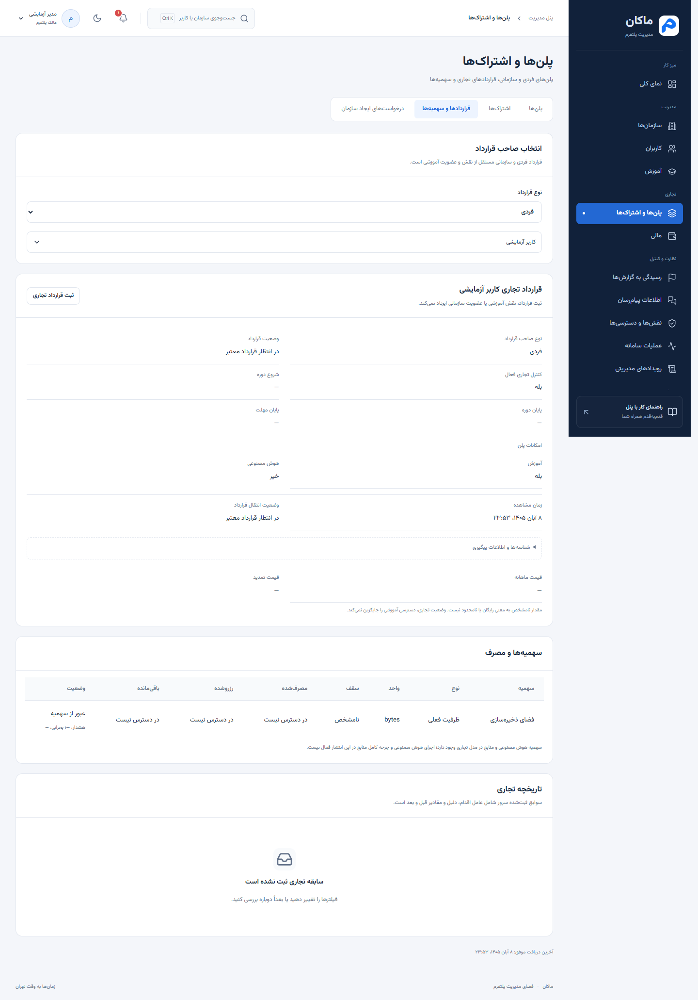
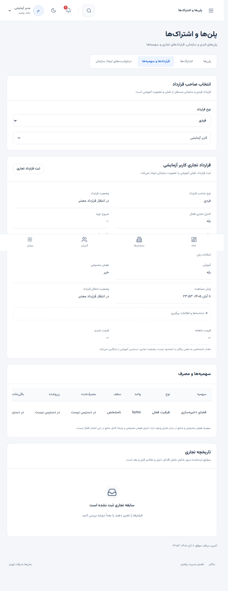
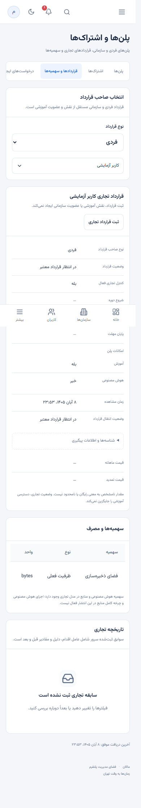

> تطبیق تازه با راهنمای 42c51a3: [وضعیت جاری و راهنما](admin-integration-42c51a3.md). Official Spaces در حوزه بک‌اند تعریف شده‌اند؛ این به معنی API تعمیر یا دسترسی محتوای خصوصی برای پنل مالک نیست.

# به‌روزرسانی پنل مدیریت ماکان

تاریخ: ۳۰ اکتبر ۲۰۲۶، ۸ آبان ۱۴۰۵. مبنا: راهنمای اتصال بک‌اند فارسی انتشار `20261030-e11d4ec` و OpenAPI سرور تست `http://94.184.32.84:8090/openapi/v1.json`.

پنل همچنان فقط با نقش دقیق `PlatformOwner` به همراه `platform.access` باز می‌شود. ورود مالک به معنی داشتن تمام مجوزهای عملیاتی نیست؛ هر صفحه و اقدام مجوز مستقل خود را دارد. هیچ شماره‌ای در کد برای ورود استثنا نشده است. فضای مدرسه، کلاینت شخصی و پروژه مستقل لندینگ وارد این تغییر نشده‌اند.

## تغییرات اعمال‌شده

قرارداد زنده از ۵۱ به ۵۹ مسیر ادمین گسترش یافت. هشت مسیر تازه در بخش Commerce اضافه شده‌اند؛ ۵۱ مسیر قبلی تغییر نکرده‌اند. قرارداد اجرایی پنل اکنون ۸۰ عملیات ادمین، ورود، حساب و اعلان را پوشش می‌دهد. فیلدها و enumهای جدید از OpenAPI تولید شده‌اند. نگاشت مجوز هشت عملیات جدید از بخش 10.3 سند گرفته شده است: دریافت با `platform.commerce.read` و تغییر با `platform.commerce.manage`.

| امکان | محل استفاده |
| --- | --- |
| خلاصه قرارداد فردی | کاربران ← پرونده کاربر ← قرارداد و سهمیه‌ها |
| خلاصه قرارداد سازمانی | سازمان‌ها ← پرونده سازمان ← قرارداد و سهمیه‌ها |
| انتخاب حساب یا سازمان برای بررسی تجاری | پلن‌ها و اشتراک‌ها ← قراردادها و سهمیه‌ها |
| نمایش وضعیت قرارداد، انتقال از اشتراک قبلی و دوره اعتبار | خلاصه قرارداد صاحب انتخاب‌شده |
| سهمیه، مصرف، رزرو و باقی‌مانده | جدول سهمیه‌ها و مصرف |
| فروش جدید، نمایش در کاتالوگ و تمدید مستقل | جزئیات پلن ← تنظیم فروش و تمدید |
| اصلاح قیمت تومانی، تقویم، شرایط فروش، هشدار و سهمیه‌های پیش‌نویس | جزئیات پلن ← ویرایش پیش‌نویس |
| اعتبارسنجی و کنترل انتشار | کنار همان نسخه پیش‌نویس |
| ثبت قرارداد فردی یا سازمانی با دلیل و نسخه جاری | خلاصه قرارداد ← ثبت قرارداد تجاری |
| تاریخچه قبل و بعد، عامل اقدام و دلیل | پایین قرارداد و جزئیات پلن |

سه وضعیت نمایش در کاتالوگ، فروش جدید و تمدید مستقل‌اند. خاموش‌کردن نمایش یک پلن به معنی لغو قرارداد جاری نیست. برای نسخه منتشرشده دکمه ویرایش پیش‌نویس ارائه نمی‌شود. انتشار پیش‌نویس فقط وقتی فعال است که اعتبارسنجی سرور `canPublish=true` بدهد؛ نسخه ارسالی نیز از همان پاسخ گرفته می‌شود.

انتخاب نسخه برای ثبت قرارداد فقط از نسخه‌های منتشرشده پلن انجام می‌شود. مخاطب پلن باید با قرارداد فردی یا سازمانی انتخاب‌شده مطابقت داشته باشد. ثبت قرارداد هیچ نقش Student، Teacher، Manager یا عضویت آموزشی ایجاد نمی‌کند.

## راهنمای کار با امکانات تازه

۱. با حساب مالک وارد شوید. از منوی «پلن‌ها و اشتراک‌ها»، تب «قراردادها و سهمیه‌ها» را باز کنید. نوع قرارداد را انتخاب و سپس صاحب آن را از فهرست واقعی حساب‌ها یا سازمان‌ها انتخاب کنید.

۲. وضعیت قرارداد و تاریخ‌های اعتبار را بررسی کنید. `LegacyPendingContract` یا «در انتظار قرارداد معتبر» به معنی تکمیل‌نشدن قرارداد جدید است؛ پنل قیمت، پلن یا شرایط آن را حدس نمی‌زند. مقدار نامشخص نیز رایگان محسوب نمی‌شود.

۳. در جدول سهمیه‌ها، سقف، مصرف، رزرو و باقی‌مانده جدا نمایش داده می‌شوند. تنها `isUnlimited=true` به صورت نامحدود نمایش داده می‌شود. اگر مصرف در دسترس نباشد، عدد آن به عنوان مصرف معتبر ارائه نمی‌شود. آستانه‌های هشدار از خود سرور خوانده می‌شوند.

۴. برای ثبت قرارداد، «ثبت قرارداد تجاری» را بزنید؛ نام و شناسه صاحب قرارداد را بررسی کنید. پلن و نسخه منتشرشده مناسب، مبدأ و شماره دوره و دلیل را وارد کنید. ثبت نهایی را تأیید و سپس نتیجه و تاریخچه سرور را بررسی کنید.

۵. برای تغییر پلن، از کاتالوگ وارد جزئیات آن شوید. «تنظیم فروش و تمدید» سه گزینه مستقل دارد و دلیل تغییر ثبت می‌شود. برای تغییر محتوای نسخه منتشرشده، نسخه تازه بسازید.

۶. در پیش‌نویس، «ویرایش پیش‌نویس» را بزنید. مقادیر موجود سرور از پیش در فرم قرار می‌گیرند. اگر قرار است پلن رایگان باشد، این تصمیم باید صریحاً تأیید شود. پس از ذخیره، اطلاعات نیازمند تکمیل و نتیجه اعتبارسنجی را ببینید. با مجازشدن انتشار، دلیل انتشار را وارد و تأیید کنید.

۷. در تعارض نسخه، ورودی شما حفظ می‌شود. ابتدا «دریافت نسخه تازه و حفظ ورودی» را بزنید، وضعیت تازه منبع را بررسی و فقط پس از بازبینی دوباره ثبت کنید. ارسال مجدد خودکار انجام نمی‌شود. قطع ارتباط یا پایان مهلت پاسخ، اثبات شکست عملیات نیست؛ پیش از اقدام دوباره وضعیت منبع را بررسی کنید.

## تصاویر راهنما

تصاویر زیر از همان رابط فعال با داده‌های محیط آزمون مستقل گرفته شده‌اند؛ اطلاعات تجاری واقعی مشتری نیستند.

نمای دسکتاپ:



نمای تبلت:



نمای موبایل؛ جدول سهمیه‌ها در محدوده خودش پیمایش افقی دارد:



## مرز امکانات این انتشار

MFA و مسیرهای قدیمی آن بازگردانده نشده‌اند. وجود سهمیه AI به معنی فعال‌شدن اجرای هوش مصنوعی نیست. برای Official Spaces، یادداشت خصوصی معلم، پاسخ خصوصی آزمون، منابع شخصی و جریان خصوصی Realtime صفحه مدیریتی یا مسیر حدسی ساخته نشده است. دسترسی پیام‌رسان همچنان متادیتا و پرونده رسیدگیِ مجاز است. خرید یا قرارداد تجاری دسترسی به محتوای خصوصی ایجاد نمی‌کند.

مقادیر dictionary مربوط به entitlementهای سرور، از جمله مقدار `false`، در اعتبارسنجی پاسخ حفظ می‌شوند. پاسخ بدون بدنه عملیات تنظیم فروش، با وضعیت ۲۰۰ یا ۲۰۴، موفقیت معتبر است و به خطای پردازش پاسخ تبدیل نمی‌شود. پاسخ ۴۰۳ موجب refresh توکن یا تکرار خودکار عملیات نمی‌شود.

## اجرا

```powershell
docker compose --env-file .env.docker up -d --build --wait --wait-timeout 120
```

نشانی ورود: http://127.0.0.1:3000/login. فایل‌های خصوصی تنظیمات و نشست‌ها حفظ می‌شوند. برای سایر دستورها README پروژه را ببینید.

## نتیجه بررسی

۱۱۵ آزمون واحد و بررسی TypeScript موفق شدند. ۲۰ سناریوی ورود و دسترسی مالک و ۶ سناریوی تازه تجاری در مرورگر موفق بودند. این سناریوها شامل Draft/Validation/Publish، پاسخ بدون بدنه، تعارض نسخه، ثبت قرارداد فردی و سازمانی، جلوگیری از تکرار روی ۴۰۳ و نمایش در عرض‌های ۳۹۰، ۸۲۰ و ۱۴۴۰ پیکسل هستند.

ورود واقعی با حساب مالک مجاز، دریافت فهرست پلن‌ها، خلاصه قرارداد فردی و سازمانی همگی پاسخ ۲۰۰ دادند. مسیر قدیمی MFA پاسخ ۴۰۴ داد و نشست مستقل آزمون با پاسخ ۲۰۴ بسته شد. کاتالوگ واقعی در زمان آزمون پلنی نداشت؛ آزمون ویرایش، اعتبارسنجی، انتشار و ثبت قرارداد روی سرور مستقل آزمون انجام شد. هیچ داده تجاری واقعی برای این بررسی ایجاد یا تغییر نکرد.


ساخت نهایی Docker موفق و کانتینر سالم روی پورت ۳۰۰۰ اجرا شد. ورود واقعی و دریافت کاتالوگ، خلاصه قرارداد فردی و سازمانی و تاریخچه از واسط خود پنل نیز پاسخ ۲۰۰ دادند؛ نشست مستقل آزمون با پاسخ ۲۰۴ بسته شد. هر شش سناریوی Docker تأیید شدند؛ در اجرای نخست یک آزمون فعال‌سازی PWA به حد زمان رسید و در تکرار مستقل طی ۴٫۴ ثانیه موفق شد. فایل‌های آفلاین و آیکون‌ها پاسخ ۲۰۰ داشتند.

نتیجه ماشینی بدون توکن و اطلاعات خصوصی در [فایل بررسی](admin-integration-20261030-verification.json) ثبت شده است.
