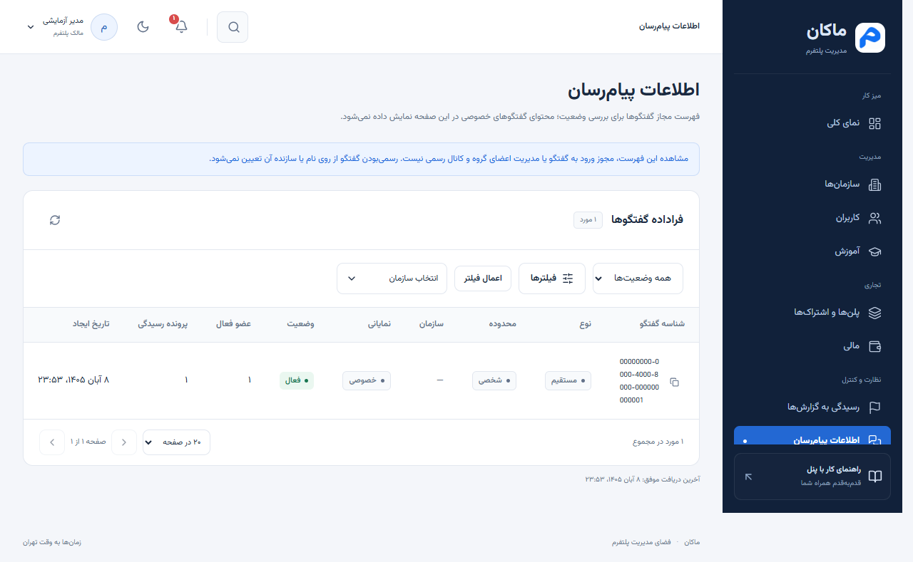
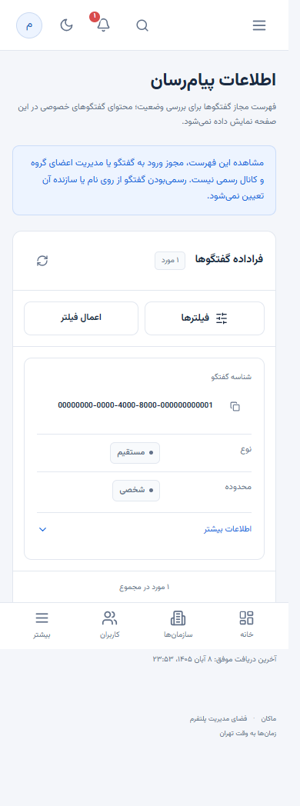

# تطبیق پنل مدیریت با راهنمای 42c51a3

تاریخ بررسی: ۳۰ اکتبر ۲۰۲۶، ۸ آبان ۱۴۰۵. مرجع: سند فارسی `MakanApp-AdminPanel-Backend-42c51a3-FA.pdf`، به‌ویژه بخش ۲۱ و پیوست D، و OpenAPI واقعی محیط تست در `http://94.184.32.84:8090/openapi/v1.json`.

پنل مالک با قرارداد زنده و مرزهای نسخه جدید تطبیق داده شد. این سند برای پنل ادمین API تازه‌ای معرفی نمی‌کند؛ تغییر عمده آن، مشخص‌کردن مسئولیت گروه و کانال رسمی و حفظ مرز دسترسی اطلاعات خصوصی است. امکانات کاربران، سازمان‌ها، آموزش فقط‌خواندنی، پلن‌ها و قراردادها، رسیدگی، عملیات و رویدادها برقرار هستند.

## تفاوت نسخه سند با وضعیت سرور

سند، Source Commit برابر `42c51a3` و بسته `20261030-official-spaces-42c51a3` را معرفی می‌کند و در زمان نگارش، استقرار آن را انجام‌نشده اعلام کرده است. این وضعیت تاریخیِ سند، به معنی تأیید یا رد استقرار کنونی نیست.

OpenAPI واقعی در زمان این بررسی، مسیرها و نوع داده‌های Official Spaces را در حوزه مدرسه و کاربر دارد. تمام ۵۹ مسیر ادمین و تمام ۸۰ عملیات قابل استفاده پنل با قرارداد قبلی برابر بودند. قرارداد اجرایی و schemaهای قابل دسترس پنل نیز دقیقاً بدون تغییر باقی ماندند. فقط نوع داده‌های کامل SDK با OpenAPI تازه همگام شدند؛ داشتن یک نوع داده در SDK به معنی مجوز فراخوانی آن API نیست.

OpenAPI فقط نسخه عمومی `1.0.0` را اعلام می‌کند و شناسه commit اجرایی نمی‌دهد؛ از آن نمی‌توان نتیجه گرفت دقیقاً کدام commit روی سرور اجرا شده است. اطلاعات snapshot این تمایز را ثبت می‌کند. قابلیت تازه ادمین، برچسب رسمی یا وضعیت آماده‌بودن بر اساس نام نسخه سند فرض نشده است.

## تغییرات انجام‌شده در پنل

- در نتیجه راه‌اندازی سازمان، راهنمای پیگیری گروه یا کانال رسمی اضافه شد: کاربر همان شناسه درخواست را به پشتیبانی می‌دهد و برای جبران خطا سازمان یا گفتگوی جایگزین ایجاد نمی‌کند.
- چک‌لیست راه‌اندازی سازمان روشن می‌کند که اعتبار سازمان، عضویت مدیر و اشتراک، تأیید آماده‌بودن گروه و کانال رسمی نیست.
- صفحه اطلاعات پیام‌رسان محدوده خود را روشن می‌کند: مشاهده فهرست مجاز، مجوز ورود به گفتگو یا مدیریت اعضای گروه رسمی نیست. نام یا سازنده گفتگو مبنای رسمی‌بودن قرار نمی‌گیرد.
- ماتریس API اکنون مجوزهای مستند هر عملیات را از نگاشت واقعی پروژه می‌خواند. عملیات حساب و اعلان اپراتور با مدیریت مدرسه اشتباه برچسب نمی‌خورند.
- قرارداد کامل و نوع داده‌های SDK با OpenAPI زنده همگام شدند. مسیرهای مدرسه، فعالیت رسمی، جریان خصوصی رویدادها و پاسخ آموزشی در واسط پنل مالک فعال نشده‌اند.

شرط ورود همچنان نقش دقیق `PlatformOwner` همراه با `platform.access` است. هر عملیات مجوز مستقل خود را دارد و مجوز از نام نقش حدس زده نمی‌شود. حساب Manager مدرسه، مالک گفتگو و نقش شخصی، مالک پلتفرم محسوب نمی‌شوند. MFA بازگردانده نشده است.

## راهنمای استفاده‌کننده

### پیگیری سازمانی که گروه رسمی آن در دسترس نیست

از «سازمان‌ها» وارد پرونده همان سازمان شوید. وضعیت سازمان، مدیر و اشتراک را جدا بررسی کنید. اگر راه‌اندازی از همین پنل انجام شده است، شناسه پیگیری درخواست را از نتیجه راه‌اندازی بردارید و همراه نام سازمان به پشتیبانی بدهید. سازمان را دوباره ایجاد نکنید. ساخت دستی گفتگو با همان نام، جایگزین گروه رسمی نیست.

نتیجه «تکمیل‌شده» برای درخواست راه‌اندازی، اثبات آماده‌بودن همه امکانات سازمان نیست. این پنل وضعیت گروه رسمی را از عنوان گفتگو، تعداد اعضا یا ایجادکننده آن حدس نمی‌زند.

### استفاده از اطلاعات پیام‌رسان

از منوی «اطلاعات پیام‌رسان» می‌توانید نوع، محدوده، سازمان، وضعیت و تعداد اعضای گفتگو را در حد داده مجاز سرور بررسی کنید. این صفحه متن پیام‌ها، فایل پاسخ دانش‌آموز، تاریخچه خصوصی یا ابزار عضویت در گفتگو ارائه نمی‌کند. برای بررسی محتوای گزارش‌شده از جریان «رسیدگی به گزارش‌ها» و مدارک مجاز همان پرونده استفاده کنید.





تصاویر از رابط فعال با داده‌های آزمون مستقل گرفته شده‌اند؛ داده واقعی کاربران نیستند.

### پلن‌ها و قراردادها

امکانات انتشار قبلی شامل قرارداد فردی و سازمانی، سهمیه‌ها، فروش و تمدید، پیش‌نویس و اعتبارسنجی پلن برقرار هستند. راهنمای آن‌ها در [راهنمای تصویری بخش تجاری](admin-integration-20261030.md) آمده است. ثبت قرارداد تجاری، نقش یا عضویت آموزشی جدید ایجاد نمی‌کند.

## مرز مسئولیت بک‌اند و پشتیبانی

طبق سند، Official Pair، اتصال رسمی گفتگو و اعضای آن از روابط معتبر سرور حاصل می‌شوند. برای تعمیر یا Backfill عمومی، API پنل Platform معرفی نشده است. ابزار maintenance، تصمیم مبهم، تأیید plan hash و اعمال تغییرات تاریخی در جریان عملیاتی بک‌اند می‌مانند. پنل برای این موارد مسیر، دکمه یا سیاست حدسی ایجاد نمی‌کند.

دسترسی والد به گروه، تاریخچه پس از پایان رابطه، سیاست مشترک Block، یادداشت خصوصی معلم و اجرای زنده AI از موضوعات تعیین‌نشده یا خارج از دامنه این تحویل هستند. دسترسی مالک، حق تازه‌ای برای پیام خصوصی، پاسخ آزمون، نمره خصوصی یا فایل دانش‌آموز ایجاد نمی‌کند.

## اجرا و بررسی

```powershell
docker compose --env-file .env.docker up -d --build --wait --wait-timeout 120
```

نشانی ورود: http://127.0.0.1:3000/login. تنظیمات خصوصی و نشست‌ها حفظ می‌شوند. پروژه مستقل لندینگ تغییر نکرده است.

۱۲۵ آزمون واحد، بررسی TypeScript، ساخت production، ۲۸ سناریوی مرورگری با سرور مستقل آزمون و هر ۶ آزمون Docker موفق شدند. در مجموع ۳۴ سناریوی مرورگری تأیید شد. نمایش پیام‌رسان در دسکتاپ و عرض موبایل ۳۹۰ پیکسل نیز بررسی شد.

ورود واقعی مالک با نقش PlatformOwner و platform.access موفق بود. ۱۶ بررسی خواندنی برای فهرست و پرونده سازمان، نقش‌ها، کاربران، آموزش، پلن، قرارداد، مالی، رسیدگی، اطلاعات پیام‌رسان، راه‌اندازی، اعلان، پردازش، سلامت و رویدادها پاسخ ۲۰۰ دادند. نشست مستقل مالک با پاسخ ۲۰۴ بسته شد. حساب آزمایشی غیرمالک معرفی‌شده، در ورود پاسخ ۴۰۳ با کد PLATFORM_OWNER_REQUIRED گرفت و برای آن نشست پنل ساخته نشد؛ بررسی نشست پاسخ ۴۰۱ داشت. مسیر قدیمی MFA پاسخ ۴۰۴ داد.

آزمون‌های دسترسی به محتوای خصوصی، داده اضافه در metadata و عملیات راه‌اندازی روی سرور مستقل آزمون انجام شدند. هیچ داده آموزشی یا تجاری واقعی ایجاد یا تغییر نکرد. کانتینر نهایی سالم و روی پورت ۳۰۰۰ فعال است.

[نتایج ماشینی بررسی بدون اطلاعات خصوصی](admin-integration-42c51a3-verification.json)
