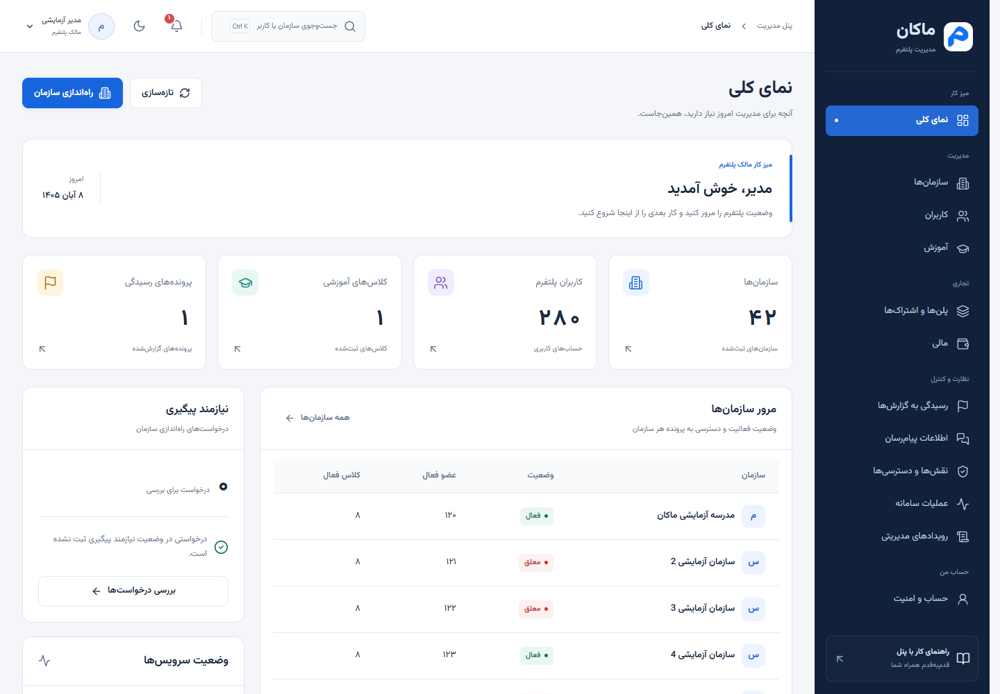
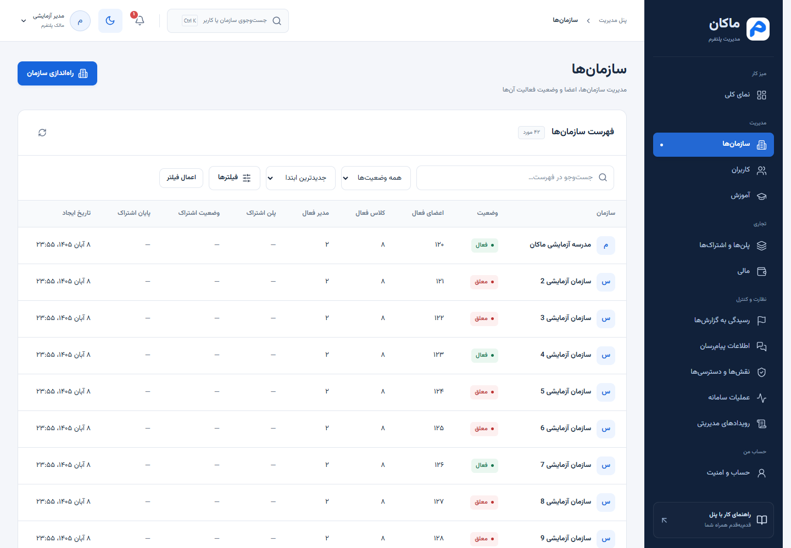
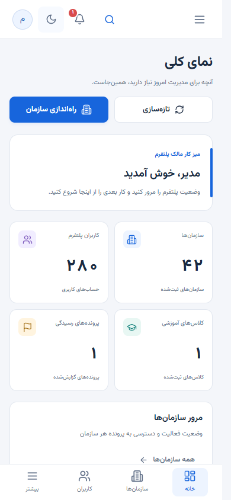
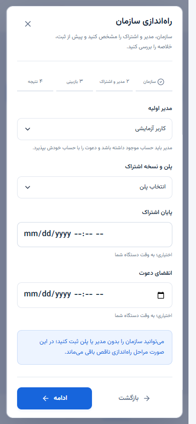
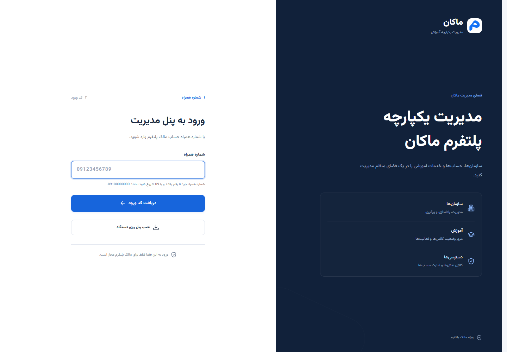

# طراحی دوباره پنل مدیریت ماکان

طراحی پنل بر اساس انتخاب مالک پروژه از نو ساخته شد: منوی سرمه‌ای، فضای کار روشن و آبی ماکان. پوسته قبلی و سبک مستقل کاتالوگ پلن از نسخه فعال خارج شدند و همه صفحه‌های پنل از ساختار و کنترل‌های مشترک استفاده می‌کنند.

## تغییراتی که در استفاده روزمره می‌بینید

| بخش             | طراحی و رفتار تازه                                                                    |
| --------------- | ------------------------------------------------------------------------------------- |
| منو             | گروه‌بندی میز کار، مدیریت، تجاری، نظارت و حساب؛ محل جاری با زمینه آبی مشخص است        |
| داشبورد         | آمار واقعی، مرور سازمان‌ها، درخواست‌های نیازمند پیگیری و دسترسی به کارهای پرکاربرد    |
| نوار بالای صفحه | مسیر جاری، جست‌وجو، اعلان و حساب؛ هنگام پیمایش در دسترس می‌ماند                       |
| فهرست‌ها        | جست‌وجو و فیلترهای اصلی در یک نوار؛ گزینه‌های تکمیلی در پنجره فیلتر                   |
| جدول‌ها         | عنوان‌های خواناتر، وضعیت‌های مشخص، شمارش و صفحه‌بندی سرور، پیمایش مستقل جدول‌های بزرگ |
| موبایل          | منوی کشویی، دسترسی پایین صفحه و کارت‌های قابل بازکردن برای جزئیات هر ردیف             |
| پرونده‌ها       | اطلاعات اصلی در اولویت؛ شناسه‌ها و نسخه‌ها در بخش بازشونده پیگیری                     |
| فرم‌ها          | کنترل‌ها و خطاهای یکدست، انتخاب نام حساب و سازمان، خلاصه پیش از ثبت و مراحل روشن      |
| فیلتر تاریخ     | انتخاب تاریخ و ساعت به وقت دستگاه؛ تبدیل لازم برای ارسال به سرور انجام می‌شود         |
| ورود            | نمایش دو مرحله شماره همراه و کد ورود، فرم کوتاه و هویت بصری تازه                      |

آمار نموداری یا روند رشد ساختگی اضافه نشده است؛ آمار داشبورد از پاسخ واقعی هر بخش می‌آید. اطلاعات در حال دریافت یا ناموفق، صفر فرض نمی‌شوند.

## راهنمای سریع

نسخه قابل ارسال برای استفاده‌کننده: [راهنمای تصویری فارسی (PDF)](../output/pdf/MakanApp_Visual_User_Guide_FA.pdf). این نسخه توضیح کار با صفحه‌ها را همراه با تصاویر و نشانه‌های راهنما دارد.

۱. بعد از ورود، «نمای کلی» میز کار شماست. برای شروع سازمان تازه، «راه‌اندازی سازمان» را بزنید. برای پیگیری حساب یا سازمان موجود، از جست‌وجوی بالای صفحه استفاده کنید. در رایانه میانبر `Ctrl+K` همین جست‌وجو را باز می‌کند.

۲. در هر فهرست، ابتدا از جست‌وجو و وضعیت استفاده کنید. با «فیلترها» گزینه‌های تکمیلی باز می‌شوند؛ پس از انتخاب، «اعمال فیلتر» را بزنید. با «پاک کردن»، فیلترهای اعمال‌شده حذف می‌شوند. جست‌وجو، فیلتر و صفحه جاری با بازگشت یا تازه‌کردن صفحه حفظ می‌شوند.

۳. در موبایل، ردیف‌ها به کارت تبدیل می‌شوند. عنوان و اطلاعات اصلی را مستقیم می‌بینید؛ «اطلاعات بیشتر» بقیه داده‌ها و اقدام‌های آن ردیف را باز می‌کند. برای رفتن به دیگر بخش‌ها از «بیشتر» یا دکمه منوی بالای صفحه استفاده کنید.

۴. در پرونده کاربر، سازمان یا پلن، بخش «شناسه‌ها و اطلاعات پیگیری» را زمانی باز کنید که شناسه‌ای برای پشتیبانی یا بررسی لازم دارید. کپی شناسه در همان بخش در دسترس است.

۵. پیش از ثبت اقدامات حساس، حساب یا سازمان مقصد، دلیل و نتیجه بررسی را مرور کنید. در تعارض نسخه، ورودی شما حفظ می‌شود و باید نسخه تازه را بگیرید. خطا یا قطع ارتباط به معنی ثبت‌نشدن قطعی عملیات نیست.

## تصویرهای طراحی تازه

تصاویر از همان پنل با داده‌های آزمون مستقل گرفته شده‌اند؛ حساب نمایشی یا مسیر دمو در نسخه اصلی فعال نشده است.











## دامنه و اجرا

این تغییر مربوط به پنل مالک است. مجوز ورود همچنان نقش دقیق PlatformOwner همراه با platform.access و مجوز مستقل هر عملیات است. اتصال واقعی، کنترل سمت سرور، حفاظت اطلاعات خصوصی، PWA و اعلان‌ها برقرار هستند. پروژه مستقل لندینگ تغییر نکرده است.

نسخه قبلی ظاهر، برای بازیابی در archive/ui-before-redesign-20261030 نگه‌داری می‌شود و در برنامه یا image Docker بارگذاری نمی‌شود. فایل‌های env و نشست‌های واقعی تغییر نکرده‌اند.

```powershell
docker compose --env-file .env.docker up -d --build --wait --wait-timeout 240
```

نشانی ورود: http://127.0.0.1:3000/login. پس از به‌روزرسانی، صفحه را تازه کنید.

## بررسی نهایی

۱۲۶ آزمون واحد و ۵۲ آزمون مرورگری موفق شدند. بررسی تصویری نهایی با ۴ آزمون دیگر نیز موفق بود. هر ۱۲ بخش در عرض‌های ۳۲۰، ۳۷۵، ۴۳۰، ۷۶۸، ۱۰۲۴، ۱۴۴۰ و ۱۹۲۰ پیکسل بدون سرریز افقی صفحه بررسی شدند. منوی موبایل، جست‌وجوی صفحه‌کلید، انتخاب مدیر، ثبت قرارداد در سرویس آزمون، فیلتر تاریخ، حالت تیره، ورود مالک، رد نقش‌های دیگر و اعلان‌ها پوشش داده شدند. typecheck و build تولید موفق بودند.

نسخه تازه با Docker ساخته و جایگزین شد و کانتینر وضعیت healthy دارد. هر ۶ آزمون Docker، شامل فایل‌های استایل و فونت، نصب، مرز نشست، نبود مسیر دمو و بازیابی خطای دریافت کد ورود موفق شدند. ورود واقعی حساب مالک آزمایشی و خواندن سازمان‌ها، کاربران، پلن‌ها و سلامت سامانه پاسخ ۲۰۰ داد؛ حساب Manager با ۴۰۳ رد شد و نشست پنل نگرفت. نشست‌های بررسی در پایان بسته شدند. هیچ عملیات تجاری روی سرور واقعی ثبت نشد.

تصاویر روی مرورگر Chrome گرفته شده‌اند؛ بررسی روی گوشی فیزیکی یا آزمون صفحه‌خوان ادعا نشده است. [جزئیات بررسی](ui-redesign-20261030-verification.json).
